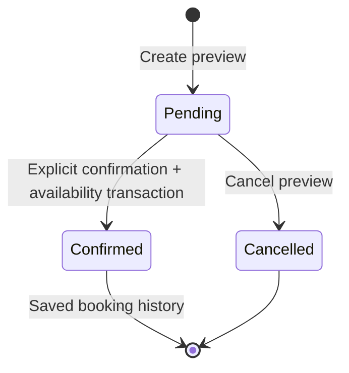

# NASHMI Architecture — MVP Technical Notes

## Boundaries and responsibilities

**Browser → FastAPI → LangGraph → tools → PostgreSQL.** Ollama provides local language-model assistance to the conversation layer. The app does not treat model-generated prose as authoritative booking state. Inventory checks and writes are handled by Python service functions.

## Booking lifecycle

The actual application uses booking statuses such as `pending_confirmation` and `confirmed` and stores a `BookingItem` against each booking. Preview cancellations are recorded in audit events. The diagram is a simplified MVP state model, not a full cancellation lifecycle for confirmed bookings.

### Flight confirmation transaction

Based on the reviewed `confirm_flight_booking` code:

1. Require `confirmed=True`.
2. Resolve the specified user; reject unknown users.
3. Lock the preview booking row using `SELECT ... FOR UPDATE`.
4. Check booking ownership, service type, booking item, and expected pending status.
5. Validate positive, non-boolean integer passenger count and resolve the flight.
6. Atomically decrement seats **only** if `available_seats >= passengers`.
7. Set booking to `confirmed` and insert a `booking_confirmed` audit event in the transaction.
8. A previously confirmed booking returns its prior confirmation without another deduction.

The targeted integration test created *two separate pending previews* competing for a shared flight with only two seats. Exactly one succeeded; remaining inventory was zero; the losing preview remained pending; one confirmation audit record was found. **This is distinct from a same-preview first-confirmation race test.**

## Database and audit design

Key models discussed in development: `User`, `Booking`, `BookingItem`, `Flight`, `FlightAvailability`, `HotelAvailability`, `RestaurantSlot`, and `AuditEvent`. The persistent booking record is the authoritative state; its associated item stores service-specific details. Preview creation, confirmation, and preview cancellation are included in audit logging.

## Quality measurement

The local evaluator in `evals/run_evals.py` uses `evals/golden_scenarios.json` to issue chat requests and generate `evals/latest_report.json`. The verified 50-scenario run reported **100% success on those 50 scenarios**, with 37 English and 13 Arabic examples; p50 latency 1,684.8 ms and p95 3,631.5 ms. These metrics are sample-specific and should be reported with date, machine/context, and evaluator version when published.

## Observability

FastAPI middleware reports request IDs, status, and latency. Database audit events capture important booking actions. Future production work should add structured distributed traces, redaction policies, failure-rate monitoring, and alerts.

## Security and isolation caveats

- Database ownership is checked against a **supplied** `user_id`, not an authenticated principal. A production deployment needs actual authentication and route-level authorization.
- Local demo booking history has been configured with a demo user (`USER-001`). Do not expose it as a public service without fixing this.
- Integration tests must explicitly connect to `nashmi_test`. The main PostgreSQL database contains demo reservations and must not be used for destructive QA.
- Current targeted tests do not prove hotel/restaurant high-contention behavior, atomic cross-service workflows, payment processing, external supplier consistency, or production security.

## Future system design: disruptions

Planned, not yet verified as implemented: a booking disruption orchestrator must reconcile a flight cancellation or schedule change across hotels and restaurants, calculate policy consequences, request confirmation before costly or irreversible operations, use idempotent retries, and persist each provider's outcome. Provider-initiated hotel/restaurant cancellations should search for compatible alternatives and propose or execute allowed rebooking steps. A saga-style workflow with compensating actions is a possible implementation strategy; it is an architectural suggestion, not a claimed current feature.
